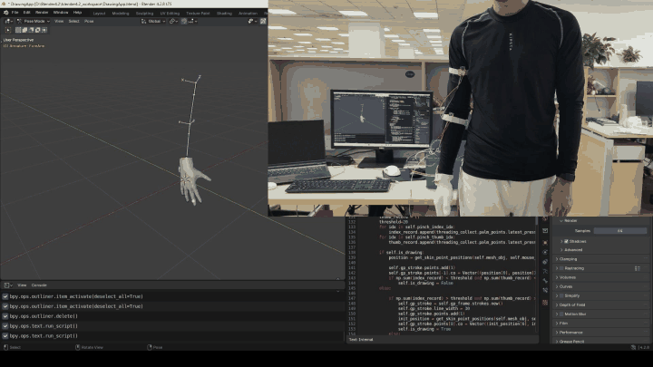
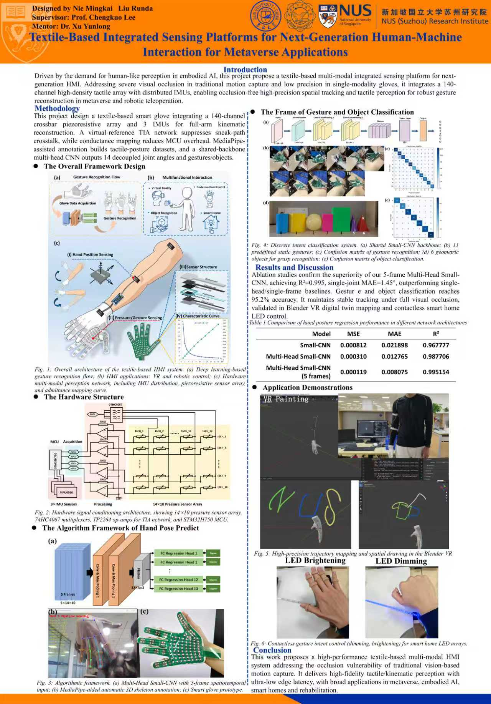

# integrating-sensoring-system-for-HMI

A textile-based multimodal sensing platform for human–machine interaction (HMI), combining a **14 × 10 pressure-sensing array** with **three IMUs** for hand posture estimation, gesture recognition and interactive 3D applications.

This repository contains the acquisition, processing, learning and visualization code for the final-year project **“Textile-Based Integrated Sensing Platforms for Next-Generation Human-Machine Interaction for Metaverse Applications.”**

## What this project does

- Collects pressure frames and IMU measurements through a shared serial connection, with calibration and threaded acquisition.
- Processes tactile signals, analyzes sensor crosstalk, and visualizes pressure distributions and IMU orientation.
- Uses MediaPipe to collect hand landmarks and joint-angle labels alongside pressure data and video.
- Trains CNN models for gesture/object classification and pressure-to-angle regression, including a five-frame input for predicting **14 hand joint angles**.
- Connects sensor-based predictions to Blender for hand/arm visualization and spatial drawing. The project poster also presents gesture-controlled LED interaction.

## Demo

[Watch / download the original full-resolution video](FYP/Hand%20Attitude%20Test%20Demo.mp4)

## Project poster

## Repository overview

| Path | Contents |
| --- | --- |
| `ThreadingCollect_class.py` | Shared serial acquisition and sensor calibration |
| `IMUProcessing/`, `MPU6050/` | IMU processing, attitude estimation and device-related code |
| `PalmPoints_and_FingerBend/` | Pressure-array processing, calibration and crosstalk analysis |
| `hand_pose_mediapipe/` | Data collection, joint-angle labels, CNN regression, evaluation and live prediction |
| `Functions/` | Gesture/object recognition and interaction applications |
| `blender/` | Hand-pose prediction, animation and 3D drawing integration |
| `HandPose_YOLO/` | Vision-based hand-pose and dual-camera experiments |
| `Func_on_collected_data/` | Recorded-data replay and visualization |
| `DataCSV/`, `Archieve/` | Recorded data and earlier experiments |
| `FYP/` | Project poster and hand-attitude demo video |

Recorded datasets, model checkpoints and experiment outputs are preserved from the original project directory.

## Running the code

This is a research prototype with hardware-specific settings, rather than a single install-and-run application. Main dependencies include Python, NumPy, pandas, PyTorch, OpenCV, MediaPipe, matplotlib, scikit-learn and pyserial. Blender-related scripts require Blender's Python environment; individual experiments may require additional packages.

Before running, update the original `D:/blender_workplace/modules` paths, serial port, camera index and model paths for your machine. Check `IMUProcessing/config.json` and `PalmPoints_and_FingerBend/PalmPointsConfig.json`, and calibrate the sensors for the connected hardware. Blender experiments also require the matching scene/rig; no `.blend` scene is supplied in this repository.

Useful starting points:

- Data collection: `hand_pose_mediapipe/dataset_collector.py` and its [collector guide](hand_pose_mediapipe/README_collector.md).
- Model training: `hand_pose_mediapipe/train_cnn_regression.py`.
- Live angle prediction: `hand_pose_mediapipe/realtime_angle_predict_FlexFrames.py`.
- Blender integration: `blender/realtime_predict_handpose_torch.py`.

## Credits

Project by **Nie Mingkai and Liu Runda**. Supervisor: **Prof. Chengkuo Lee**. Mentor: **Dr. Xu Yunlong**. Project description and credits follow the included poster.
